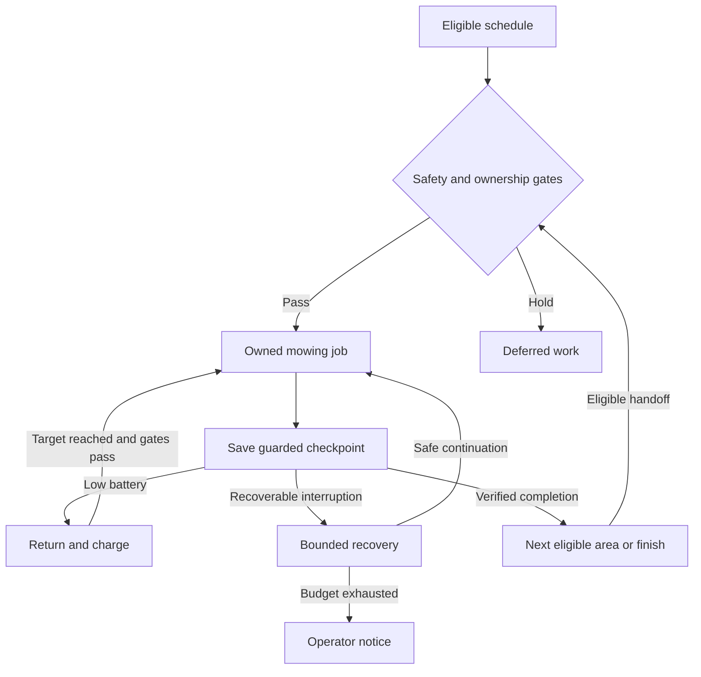

# Mammotion mower automations for Home Assistant

An **alpha reference package** for coordinating a Mammotion mower through Home Assistant: scheduling areas, preserving unfinished work, returning to charge, and recovering from selected interruptions with bounded retries.

This release shares the automation logic developed through real use, with installation-specific bindings removed. It needs technical commissioning. It is not a universal blueprint or a promise of unattended operation, and the public adaptation has not been physically validated on another installation.

## What it helps do

- Keep one owner of the active job, so schedule, recovery and handoff paths cooperate.
- Preserve progress and pending areas when telemetry arrives late or an acknowledgement fails.
- Refresh status after dispatch and distinguish a delayed report from an actual failed start without blindly issuing duplicate starts.
- Resume an eligible interrupted job from a saved checkpoint, subject to route identity and safety checks.
- Return on low battery, calculate a recharge target, and retain unfinished work while charging.
- Attempt a consecutive-area handoff when battery, ownership and safety gates allow it.
- Retry selected stuck/return failures within a finite recovery budget, then surface an intervention notice.
- Apply rain, weather freshness, presence, manual hold, time-window and map-consistency checks.

A saved percentage is not proof of complete physical coverage. A Dock command is not proof of successful docking. Alerts and human intervention remain part of the operating model.

## How it works

The scheduler chooses eligible work. An owner script records the active area and job token; progress observers save a guarded checkpoint. Completion checks advance the queue. Recovery and return routines consult the same ownership state before acting. Map identifiers and route settings are included in checkpoint identity so an old checkpoint cannot silently be applied to a changed route.

The source contains 34 configurations (26 automations and 8 scripts), 67 helper definitions and 43 required local bindings. A local compiler replaces binding tokens with your installation's entity IDs, map hashes and device ID, then emits a Home Assistant package. Exhausted-recovery notices use Home Assistant persistent notifications; other operator alerts use a locally bound notification action. The compiler also normalizes empty selectors so Home Assistant package merging preserves them. Local settings and generated output belong outside version control.

Starts and resumes are initially disarmed: the package enable helper starts off, manual hold starts on, and unset not-before dates block dispatch until explicitly configured. Automations load enabled on first install and restore their enabled state thereafter. Dock-only protective automations remain available when the motion gate is off, including after a restart. Install with the mower safely parked and follow commissioning before arming motion.

## Get started

1. Read [Setup and commissioning](docs/SETUP.md), including the dependency contract and persistent-state warning.
2. Prepare private local bindings and generate the package.
3. Validate the generated package on your Home Assistant installation with dispatch disabled.
4. Commission during ordinary, supervised mowing and record evidence using the [validation checklist](docs/VALIDATION.md).

## Scope and limitations

The reference topology has five logical zones backed by six native areas, a seasonal grouped schedule, and fixed route profiles. Adapting a different topology requires source changes as well as bindings. Command parameters such as blade height, speed and collection mode are fixed reference values that can override app settings; review the setup guide's fixed-behavior table for model compatibility. Scheduling windows, seasonal assumptions, battery thresholds and recovery classifications must fit your mower, integration and property.

The reviewed public package passed 65 synthetic tests and isolated Home Assistant Core 2026.10.2 configuration validation. Those checks contacted no live instance or devices and do not certify physical behavior on another installation. See the reproducible commands in the validation guide. The extra 30-second position-telemetry recovery grace still needs confirmation during a naturally occurring event. Charger-free handoff, delayed scheduled-launch telemetry, uninterrupted recovery and sustained docking should all be treated as commissioning checks, not guaranteed features.

## Contributing and privacy

Useful contributions include anonymized failure cases, integration compatibility reports, focused tests and clearer setup instructions. Share the package version, integration version, relevant state transitions and expected/actual behavior. Do not attach raw traces, maps, backups or generated packages to public issues: they can contain coordinates, household entities and device identifiers. Reproduce with synthetic data or redact and inspect every field first. If private reporting is unavailable, omit sensitive details rather than posting them publicly.

Licensed under [MIT](LICENSE). This is a community project and is not affiliated with Mammotion or Home Assistant.
